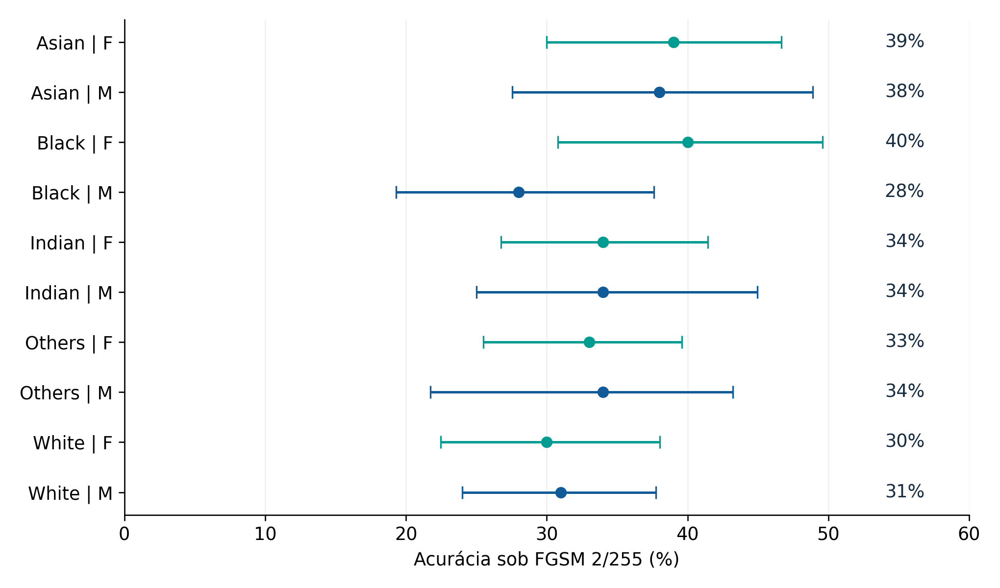

# Justiça algorítmica na detecção de manipulações faciais

Na minha segunda iniciação científica na UFSCar, investiguei uma questão que surgiu ao estudar detecção de deepfakes. Mesmo quando um detector acerta quase todas as imagens, como os erros se distribuem entre grupos? Comparei falsos positivos e falsos negativos por raça e gênero anotados na base e avaliei o que mudava quando a qualidade da imagem ou a origem dos dados variava.

**Julia Campanelli Granja** · Departamento de Computação, UFSCar  
**Orientação** · Profa. Dra. Marcela Xavier Ribeiro

## Experimento

A partir da UTKFace, formei 1.500 pares de imagens, cada um com uma foto original e uma versão com composição facial controlada. As 3.000 imagens foram divididas igualmente entre treino, validação e teste. Ajustei uma rede Xception para classificar imagens reais e manipuladas. Usei os rótulos demográficos da base para auditar as previsões. A composição facial foi realizada por processamento de imagens, o que limita a extensão dos resultados a outros tipos de falsificação.

## Resultados

| Avaliação | Imagens de teste | Acurácia |
|---|---:|---:|
| UTKFace, teste controlado sem perturbação | 1.000 | 99,7% |
| Mesmo teste com perturbação FGSM de 2/255 | 1.000 | 34,1% |
| CIPLab, teste externo | 2.041 | 49,19% |
| Human Faces, teste externo | 9.630 | 98,72% |

No teste controlado sem perturbação, houve um falso positivo e dois falsos negativos. Já no CIPLab, o detector marcou 923 das 1.081 fotos reais como falsas. Essa diferença mostra por que avaliei o mesmo modelo em bases de origens distintas.

*Figura 1. Cada ponto mostra a acurácia de um grupo sob FGSM de 2/255. As barras mostram intervalos de 95% estimados por bootstrap. A diferença observada entre o maior e o menor valor foi de 12 pontos percentuais. O estudo não estabeleceu significância estatística para essa diferença.*

Os grupos refletem as categorias anotadas na UTKFace e podem divergir da identidade autodeclarada. Resolução, iluminação e qualidade da composição também podem influenciar os erros. As bases externas permitem comparar a generalização do detector, mas carecem de anotações demográficas verificadas para esta auditoria.

## Explorar os resultados

- [Pôster do CIC em PDF](poster/poster-cic.pdf) — metodologia, resultados e discussão ética.
- [Métricas por grupo](resultados/auditoria/metricas_por_grupo.csv) — contagens e taxas por condição. A classe positiva corresponde à imagem manipulada.
- [Disparidades](resultados/auditoria/disparidades.csv) e [intervalos](resultados/auditoria/intervalos_cluster.csv) — diferenças entre grupos e incerteza das estimativas.
- [Métricas externas](resultados/externos/metricas_externas.csv), [matrizes de confusão](resultados/externos/matrizes_externas.png) e [curvas ROC](resultados/externos/roc_externa.png) — desempenho nas duas bases externas. A [configuração da avaliação](resultados/externos/config_externo.json) registra o limiar, as versões do ambiente e os identificadores dos arquivos usados.

## Executar no Google Colab

Baixe ou abra os arquivos da pasta [notebooks](notebooks) no Google Colab. Execute as células de cada notebook de cima para baixo e monte o mesmo Drive entre sessões. As células iniciais cuidam das dependências específicas. Para começar do zero, coloque a base UTKFace em `Meu Drive/tcc_justica/UTK.zip`. O notebook 01 procura o preditor de 68 pontos faciais nessa mesma pasta e tenta baixá-lo caso esteja ausente. Use preferencialmente GPU para o treinamento.

| Etapa | O que faz |
|---|---|
| 00 | Lê os rótulos nos nomes dos arquivos e prepara as divisões do conjunto. |
| 01 | Gera os pares original/manipulada e grava o manifesto da execução. |
| 02 | Treina a Xception e salva o checkpoint com melhor perda de validação. |
| 03 | Carrega o checkpoint e calcula as previsões no teste sem perturbação. |
| 04 | Avalia o mesmo teste sob ruído, compressão JPEG e perturbações FGSM. |
| 05 | Calcula métricas por grupo, disparidades e intervalos a partir das previsões. |
| 06 | Análise histórica independente com dados tabulares incorporados. Pode ser executada em CPU e separadamente das demais etapas. |
| 07 | Prepara as bases externas CIPLab e Human Faces e gera o manifesto externo. |
| 08 | Avalia o checkpoint de 02 nas bases preparadas em 07. |

**Piloto e experimento ampliado.** Os notebooks vêm configurados para o piloto de 10 pares por grupo e divisão. Para usar o tamanho do experimento do pôster, defina no 01 `MAX_PAIRS=50` e `RUN='ampliado_50'`. No 02, aponte `DATASET` para o novo manifesto e dê um novo nome a `RUN`. Nos notebooks 03 a 05 e 08, ajuste os caminhos do manifesto, do checkpoint e dos resultados para a mesma execução. Para o teste externo completo, no 08 escolha outro nome de execução e defina `MAX_PER_CLASS=None`. A avaliação externa registrada aqui usou apenas a condição sem perturbação.

Os pesos treinados e os conjuntos completos de imagens precisam ser obtidos ou gerados à parte. Os arquivos de resultados e o pôster podem ser consultados diretamente. Uma nova execução pode produzir valores diferentes dos registrados.
